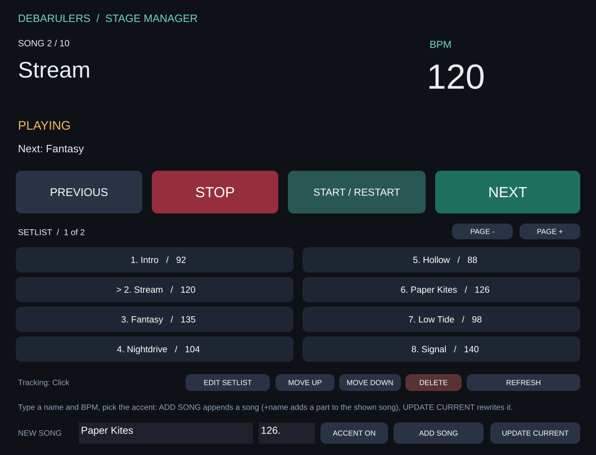

# Debarulers Stage Manager, prototype v0.1

A Max for Live panel for driving the scenes of your Ableton set: big song name and BPM, clickable setlist, previous, next, restart and stop, plus a setlist editor (song name + BPM) and a built-in Pro Tools-style click.

*Preview drawn from the patch layout by `render_ui.cjs` (`node render_ui.cjs`), not a Max screenshot.*

**A ready-made `.amxd` is built by GitHub Actions** (`build_amxd.cjs`, no Max needed): download `Debarulers-Stage-Manager.zip` from the latest Release, or the build artifact of any Actions run. The `.amxd` is frozen: it is the only file you need. Target: Live 11/12 with Max for Live (Max 8 or later). The logic was checked by simulation and the patch wiring verified; behaviour and rendering inside Live/Max still need to be validated on your Mac.

## Install from a build

1. Take `Debarulers-Stage-Manager.amxd` from the zip (or `dist/`) and put it anywhere, e.g. your User Library.
2. Drag it onto the MIDI track that plays the click, **as its instrument, outside any Rack**. It replaces the Drum Rack: the device synthesises the click itself (C1 = accent, any other note = beat).
3. Click **OPEN PANEL**, then REFRESH if needed. Save the Ableton set.

To build locally: `node build_amxd.cjs` writes the frozen `dist/Debarulers-Stage-Manager.amxd`, with `stage_click.js` embedded in it. Pushing a `v*` tag attaches the zip to a GitHub Release.

## Manual install from the Max editor (fallback)

1. Unzip the folder and keep it somewhere permanent, e.g. Documents/Debarulers-Stage-Manager. Keep `stage_click.js` next to the future `.amxd` file.
2. In your Ableton set, drop an empty **Max Instrument** on the MIDI track that plays the click, in place of the Drum Rack and outside any Rack. Only one instance is needed.
3. Click the device's edit button to open Max. In Max: File > Open, pick `Debarulers-Stage-Manager.maxpat`. Switch to Patching mode if presentation hides the objects, unlock the patch (`Cmd + E`), then select all and copy (`Cmd + A`, `Cmd + C`).
4. Go back to the empty Max Instrument window opened from Live. Switch to Patching mode, unlock, select and delete its objects, then paste. The supplied patch already contains `midiin`, `plugout~` and `live.thisdevice`.
5. Save this **Max for Live device** with Save As, as `Debarulers-Stage-Manager.amxd`, **in the same folder as `stage_click.js`**. Close the editor. Reload the saved device on the click track so the API and script lookup initialise. Do not just rename the `.maxpat` to `.amxd`.
6. Click **OPEN PANEL**. If needed, click REFRESH. The floating window shows the tracked track name at the bottom. Save the Ableton set.

Once validated, you can freeze the device from Max to embed its dependencies. Until it is frozen, keep the `.js` next to the `.amxd` and share both files together.

## Building the setlist

At the bottom of the panel, type a song name and its BPM:

- **ADD SONG** inserts a scene right after the last song (empty scenes stay below), named after the song, with its tempo enabled, and creates a looped one-bar 4/4 click clip on the tracked track: C1 (accent) on beat 1, C#1 on beats 2-4.
- **ACCENT ON / NO ACCENT** picks, per song, whether beat 1 is accented. ADD SONG and UPDATE CURRENT write it into the song's clip: the first beat of every 4/4 bar becomes C1 (accent) or C#1 (plain). Other notes are left alone.
- **UPDATE CURRENT** renames, re-tempos and re-accents the song shown at the top.
- **ACCENT 1** on the device face (next to OPEN PANEL) is the global switch, saved with the set: off, every song plays without accent whatever its clip says.

To reorder or delete songs from the panel, stop playback and turn on **EDIT SETLIST**. Clicking a title then only selects it, without launching it:

- **MOVE UP / MOVE DOWN** swaps the selected song with the previous or next song: their clips on every track, name, tempo, time signature and color. Empty scenes in between stay where they are.
- **DELETE** removes the selected song's scene, with its clips on every track, like deleting the scene in Live. Press it twice within 4 seconds to confirm.

Turn EDIT SETLIST off before the gig so titles launch songs again. Each edit is several steps in Live's undo history. You can still drag or delete scenes in Live; the panel follows on its next rescan. Other time signatures: edit the clip in Live.

## The click sound

The device synthesises a short sine blip modelled on the Pro Tools click, so no sample file (and no Avid sound) is needed. It plays on the clips' notes: C1 = accent (1760 Hz), any other note = beat (1320 Hz), so existing click clips keep sounding. To retune, edit the `cycle~` frequency or the decay length (`1, 0 60` = 60 ms) in the top patcher in `Debarulers-Stage-Manager.maxpat`, then rebuild.

## Preparing the set

- Keep your existing click track and looped MIDI clips.
- One scene per song, with its name and its BPM enabled in the scene settings.
- Only scenes with a clip on the click track are in the setlist: empty scenes (like Live's default ones) are hidden.
- Disable Follow Actions on clips and scenes to keep transitions manual.
- Set clips to Trigger mode, Loop on and Legato off so they restart from the beginning.
- The panel respects Live's and the clips' launch quantization. During playback a launch may wait for the next bar; the screen shows PENDING. It does not impose a different quantization.
- Do not arm other tracks; a scene launch fires all its clips, just like Live's scene button. The device targets your click set, not a recording session.
- The click comes out of this track: route its output to the in-ears as before. The device changes neither volumes nor routing.

## Usage

| Control | Result |
|---|---|
| START / RESTART | Launches the current scene, including after a stop. |
| NEXT | Launches the next scene in a single press. |
| PREVIOUS | Launches the previous scene in a single press. |
| STOP | Immediately stops all Session clips, cancels pending launches and stops the global transport. |
| Click a title | Launches that scene directly. |
| PAGE - / PAGE + | Shows other titles without changing playback. |
| REFRESH | Rescans scenes, or retries the connection after install. |
| ADD SONG | Creates a scene + click clip from the name and BPM fields. |
| ACCENT ON / NO ACCENT | Per-song accent used by ADD SONG and UPDATE CURRENT. |
| UPDATE CURRENT | Writes the name, BPM and accent fields to the current song. |
| EDIT SETLIST | Edit mode: titles select instead of launch; needs playback stopped. |
| MOVE UP / MOVE DOWN | In edit mode, moves the selected song one place. |
| DELETE | In edit mode, press twice to delete the selected song. |
| ACCENT 1 (device face) | Global accent on/off for every song. |

For the first song, click its title or use START if the right song is already shown. The device never starts anything on load.

The panel follows the `playing_slot_index` of its host track: if you launch a scene from Live, its title becomes the current song. When stopped, it keeps the last song so NEXT still works. Live's automatic selection of the next scene therefore does not shift the panel.

At the ends of the list, previous/next do not wrap. A 400 ms guard limits double presses. While a launch is pending, other launches are ignored; STOP cancels it.

The BPM shown during playback is Live's; when stopped, it is the scene's configured tempo. GLOBAL means the scene has no active tempo and inherits the global tempo. Set its tempo in Ableton to get the song's own BPM.

## Validation in Live before a gig

1. Launch the first song: check the click and its BPM.
2. STOP then NEXT: the second song must start at its tempo with no extra action.
3. Test PREVIOUS, START and clicking a title directly.
4. Launch a song directly from Live's grid: the panel must follow it.
5. Check STOP during a quantized launch, and the first/last song limits.
6. Save, close and reopen the set: no click must start on open; the panel must reconnect.

If the panel stays empty, open the Max console and look for a `js` error. If the message asks for a MIDI track, move the device directly onto the click track, outside any Rack. Once the device is saved in the right place, remove it and load it again.

## Technical references

- Scene API: https://docs.cycling74.com/apiref/lom/scene/
- Transport and stop: https://docs.cycling74.com/apiref/lom/song/
- Track and playing_slot_index: https://docs.cycling74.com/apiref/lom/track/
- Max for Live interfaces: https://docs.cycling74.com/userguide/m4l/live_userinterfaces/

The supplied tests use a simulated API. They do not replace audio, visual and integration validation in Ableton.
